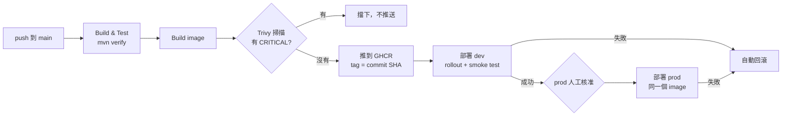

# rack-monitor：機櫃感測資料 API × CI/CD 練習專案

一個刻意保持簡單的 Spring Boot API（接收機櫃的功率與進風溫度、超過門檻標記告警），
重點放在**從 push 到上線的整條自動化流程**：測試 → 弱點掃描 → 建 image → 部署 dev → 人工核准 → 部署 prod，
部署失敗時自動回滾。

## Pipeline 流程



PR 只跑 Build & Test；merge 到 main 才會建 image 和部署。

## 設計重點

| 做法 | 原因 |
|---|---|
| 先掃描、再推送 image | 沒通過掃描的 image 根本不會進 registry |
| image tag 用 commit SHA，不用 `latest` | 線上跑的是哪一版程式碼一清二楚，回滾也指得出版本 |
| Build once, deploy many | dev 和 prod 用同一個 image，環境差異交給 ConfigMap；測過的就是上線的 |
| 部署用的 manifest 在 CI 先渲染好存成 artifact | 每次部署的實際內容可追溯 |
| `maxUnavailable: 0` 的滾動更新 | 新 Pod ready 之前不拿掉舊 Pod，更新過程不中斷服務 |
| readiness / liveness probe（Spring Boot Actuator） | 還沒準備好就不導流量；卡死就重啟 |
| rollout 逾時或 smoke test 失敗 → `rollout undo` | 壞版本不會留在線上 |
| ConfigMap 由 kustomize 產生（名稱帶 hash） | 設定一改就自動觸發滾動更新 |
| API 金鑰來自 GitHub 環境密鑰 → K8s Secret | 金鑰不進 repo，dev / prod 各用一把 |
| 每個 kubectl 指令都明確指定 `--context` | 避免誤部署到其他叢集 |
| Trivy 固定版本（0.69.3），不用 `latest` | 2026 年 3 月 Trivy 發生供應鏈攻擊，部分版本與 action tag 被植入惡意程式 |
| dev / prod 共用一份可重用 workflow（`deploy.yml`） | 部署步驟只維護一份 |

## API

| 方法 | 路徑 | 說明 |
|---|---|---|
| POST | `/api/readings` | 寫入一筆資料（需 `X-API-KEY` header） |
| GET | `/api/racks/{rackId}/latest` | 查某機櫃最新一筆 |
| GET | `/api/info` | 目前版本（commit SHA）、環境、告警門檻 |
| GET | `/actuator/health/readiness`、`/liveness` | 給 K8s probe 用 |

資料存在記憶體（示範用），重啟會清空。

---

## 一、本機先跑起來（約 5 分鐘）

需要 JDK 21 與 Maven。

```powershell
mvn verify                      # 跑測試並打包
java -jar target/rack-monitor.jar
```

另開一個 PowerShell 視窗測試：

```powershell
Invoke-RestMethod http://localhost:8080/api/info

$body = '{"rackId":"R-01","powerKw":4.2,"inletTemp":29.5}'
Invoke-RestMethod -Method Post -Uri http://localhost:8080/api/readings -ContentType 'application/json' -Body $body

Invoke-RestMethod http://localhost:8080/api/racks/R-01/latest
```

本機沒設金鑰時不檢查 `X-API-KEY`。

## 二、一次性設定（約 40 分鐘）

### 1. Rancher Desktop

- Preferences → Kubernetes：勾選 **Enable Kubernetes**
- Container Engine：**dockerd (moby)**
- 確認叢集可用：

```powershell
kubectl config get-contexts     # 要看到 rancher-desktop
kubectl --context rancher-desktop get nodes
```

### 2. 建立 GitHub repo 並推上去

建立 **public** repo（例如 `rack-monitor`），然後：

```powershell
git init
git add .
git commit -m "init: rack-monitor with CI/CD"
git branch -M main
git remote add origin https://github.com/<你的帳號>/rack-monitor.git
git push -u origin main
```

> 為什麼用 public：免費方案下，private repo 無法使用 prod 環境的「需人工核准」功能。

第一次 push 會觸發 pipeline，部署那步會停在「等 runner」，先繼續下面的設定。

### 3. 建立兩個環境與密鑰

repo → **Settings → Environments**：

| 環境 | 設定 |
|---|---|
| `dev` | Environment secret：`API_KEY` = 任一英數字串（例如 `devkey123`） |
| `prod` | Environment secret：`API_KEY` = 另一個英數字串；勾選 **Required reviewers** 並加入自己 |

金鑰請只用英數字，避免命令列特殊字元問題。

### 4. 保護 self-hosted runner（public repo 必做）

public repo 的任何人都能發 PR，而 PR 有機會改 workflow 讓程式跑在你的電腦上。

repo → **Settings → Actions → General → Fork pull request workflows**：
選 **Require approval for all external contributors**。

另外，本專案的部署 job 只在 push 到 main 時執行，PR 不會觸發部署。**面試結束後建議移除 runner**。

### 5. 安裝 self-hosted runner（Windows）

repo → **Settings → Actions → Runners → New self-hosted runner** → 選 Windows，照頁面指令下載解壓縮。
執行 `config.cmd` 時：

- 問到 labels 時輸入：`local-k8s`
- 問到是否以 service 執行時選 **N**

設定完成後，用**你自己的帳號**開 PowerShell 執行：

```powershell
.\run.cmd
```

> 不要裝成 Windows service：service 帳號讀不到你的 kubectl 與 `~/.kube/config`。

### 6. 把 image 設成公開

第一次 pipeline 的 image job 跑完後，到 GitHub 個人頁 → **Packages → rack-monitor → Package settings → Change visibility → Public**。
（K8s 才拉得到 image，不用另外設定 pull secret。）

- 如果 runner 還沒啟動：部署 job 會在排隊，image 設成公開後再啟動 runner 即可。
- 如果部署已經先跑而失敗（ImagePullBackOff）：image 設成公開後，到 Actions 頁面對那次執行按 **Re-run failed jobs**。

> 如果 Trivy 在第一次就擋下，通常是 base image 有已修補但尚未更新的 CRITICAL 漏洞：先看 log 是哪個套件，
> 換新的 base image tag；確實無法修補時，可建立 `.trivyignore` 列出該 CVE 並註明原因。

## 三、查看部署結果

```powershell
kubectl --context rancher-desktop -n rack-dev get pods
kubectl --context rancher-desktop -n rack-dev port-forward svc/rack-monitor 8081:80
# 另一個視窗
Invoke-RestMethod http://localhost:8081/api/info
```

prod 用 `rack-prod` namespace、port 換 8082。`version` 會顯示 commit SHA 前 7 碼。

---

## 四、Demo 劇本

### A. 正常流程
push 一個小改動 → 截圖 Actions 全綠、prod 停在 **Waiting for review** → 核准 → `/api/info` 的版本變成新的 SHA。

### B. 弱點掃描擋下（約 15 分鐘）
在 `pom.xml` 的 `<dependencies>` 加入有名的 Log4Shell 漏洞版本：

```xml
<dependency>
    <groupId>org.apache.logging.log4j</groupId>
    <artifactId>log4j-core</artifactId>
    <version>2.14.1</version>
</dependency>
```

push → **Build, Scan & Push Image** 失敗，log 中可看到 CVE-2021-44228，image 沒有被推送，也沒有部署。
截圖後把這段刪掉再 push。

### C. 壞版本自動回滾（約 10 分鐘）
把 `k8s/overlays/dev/kustomization.yaml` 的 `DEMO_UNHEALTHY=false` 改成 `true` → push。

- 新版應用程式啟動即失敗，Pod 永遠不會 ready → `rollout status` 逾時（約 2.5 分鐘）
- **Roll back on failure** 自動執行 `rollout undo`
- 因為 `maxUnavailable: 0`，整個過程舊 Pod 持續服務，`/api/info` 一直可用
- prod 不會被部署

截圖後改回 `false` 再 push。

### D. 叢集本身的自我修復與擴展（手動）

```powershell
kubectl --context rancher-desktop -n rack-prod get pods
kubectl --context rancher-desktop -n rack-prod delete pod <其中一個 pod 名稱>
kubectl --context rancher-desktop -n rack-prod get pods -w          # 看它自動補一個新的
kubectl --context rancher-desktop -n rack-prod scale deployment/rack-monitor --replicas=3
kubectl --context rancher-desktop -n rack-prod rollout history deployment/rack-monitor
```

---

## 已知限制與下一步

- 資料存在記憶體；正式環境會換成資料庫（例如託管的 PostgreSQL）
- 叢集在本機；正式環境會是雲端叢集（例如 AKS），部署改用 OIDC 登入、不放長期金鑰
- 目前是 pipeline 主動推送部署（push）；下一步想試 GitOps（Argo CD 從 Git 拉期望狀態）
- 第三方 action 目前用版本 tag；更嚴謹的做法是釘到 commit SHA
- 尚未加入監控告警（Prometheus / Grafana）與 HPA 自動擴展
