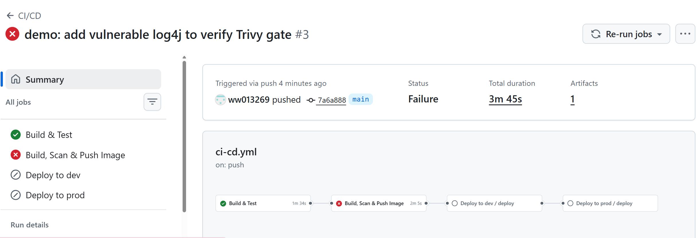
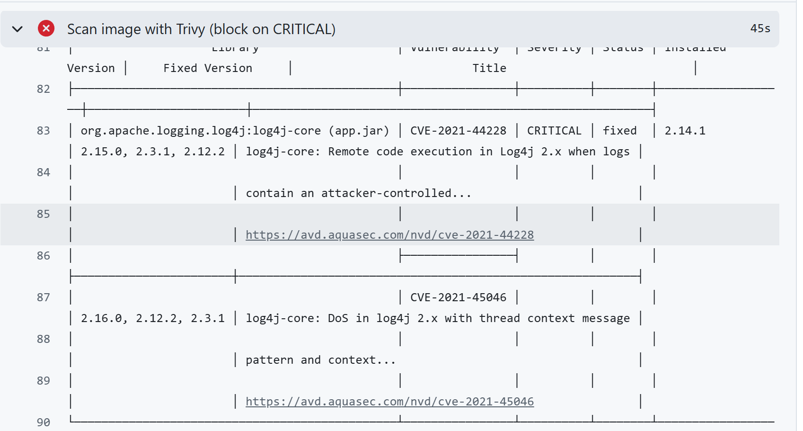
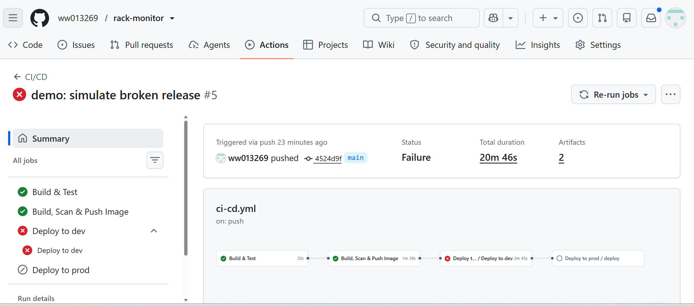
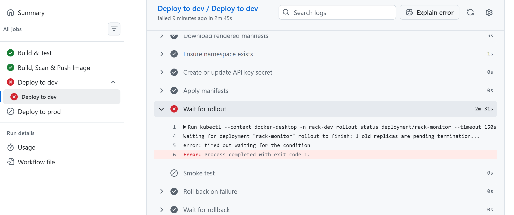

# 專案導覽：從程式碼到上線

這份文件說明 rack-monitor 的每一層在做什麼、為什麼這樣設計，以及實際跑過的三個驗證情境。
安裝步驟請看 [README](../README.md)。

**目錄**

- [一分鐘摘要](#一分鐘摘要)
- [整條流程](#整條流程)
- [實際驗證紀錄](#實際驗證紀錄)
- [① 應用程式](#-應用程式)
- [② Dockerfile](#-dockerfile)
- [③ CI：ci-cd.yml](#-cici-cdyml)
- [④ Kubernetes 設定](#-kubernetes-設定)
- [⑤ CD：deploy.yml](#-cddeployyml)
- [⑥ GitHub 安全設定](#-github-安全設定)
- [常見問題](#常見問題)
- [已知限制與改進方向](#已知限制與改進方向)
- [名詞速查](#名詞速查)

---

## 一分鐘摘要

> 用 GitHub Actions 建完整的 CI/CD。每次 push 會自動跑測試、打包成 Docker image，再用 Trivy 做弱點掃描，有 CRITICAL 漏洞就擋下。
>
> 通過的 image 推到 GHCR，自動部署到 Kubernetes 的 dev 環境；prod 需要人工核准。
>
> 部署時會等新版通過健康檢查，失敗就自動 rollback，所以壞版本不會影響服務，也不會進到 prod。
>
> 實際測過：加入 Log4Shell 漏洞的套件會被掃描擋下；故意放壞掉的版本，系統會自動退回舊版。
>
> 過程中 Trivy 還真的抓到 Spring Boot 內建 Tomcat 的 CRITICAL 漏洞，用升級版本修正，而不是加進忽略清單。

---

## 整條流程

用工廠來比喻：

```
push 程式碼
   ↓
① 品管  Build & Test
   編譯 + 跑測試，壞掉就停
   ↓
② 包裝  Build Image
   把程式裝進 Docker image
   ↓
③ 安檢  Trivy 掃描
   有 CRITICAL 漏洞就不准出貨
   ↓
④ 入庫  Push to GHCR
   合格的 image 存進倉庫
   ↓
⑤ 試賣  Deploy to dev
   起不來就自動退回舊版
   ↓
⑥ 簽核  人工核准
   一定要有人按「同意」
   ↓
⑦ 上架  Deploy to prod
   2 個副本，一個掛了另一個頂著
```

- **CI**（持續整合）= ①–④：每次改程式都自動檢查、打包
- **CD**（持續部署）= ⑤–⑦：自動把版本送上線

```
rack-monitor/
├── src/            ① 應用程式
├── pom.xml            Maven 設定
├── Dockerfile      ② 打包方式
├── .github/workflows/
│   ├── ci-cd.yml   ③ 主流程
│   └── deploy.yml  ⑤ 部署流程
└── k8s/
    ├── base/       ④ K8s 共用設定
    └── overlays/      dev / prod 差異
```

---

## 實際驗證紀錄

### 真實事件：Trivy 擋下 Tomcat 漏洞

第一次推上 GitHub，Trivy 就擋下了 image：

| 項目 | 內容 |
|---|---|
| 套件 | `tomcat-embed-core` 11.0.24 |
| 來源 | Spring Boot 4.1.1 內建（當時最新版） |
| 漏洞 | CVE-2026-65182、CVE-2026-65905、CVE-2026-68525，皆為 CRITICAL |
| base image | Ubuntu 層 0 個漏洞 |
| 修正 | `pom.xml` 加上 `<tomcat.version>11.0.27</tomcat.version>` |

**重點：用升級修正，沒有用 `.trivyignore` 把警告關掉。** 這不是演出來的，是掃描關卡真的發揮作用。

（同一天還遇到一次 Maven Central 回 500 錯誤，屬於外部服務暫時故障，重跑就過了。）

### Demo A：正常流程 + build once, deploy many

| 環境 | Pod | `/api/info` |
|---|---|---|
| dev | 1 個 Running | `version: ca40e1a`, `env: dev` |
| prod | 2 個 Running | `version: ca40e1a`, `env: prod` |

兩邊版本號一樣 → **同一個 image**，只是設定不同。測過的就是上線的。

### Demo B：弱點掃描擋下 Log4Shell

在 `pom.xml` 加入有名的漏洞套件 `log4j-core 2.14.1`。



Build & Test 通過（程式本身沒問題），但 Build, Scan & Push Image 失敗，dev / prod 都沒部署。



Trivy 找到 **CVE-2021-44228**（Log4Shell，遠端程式碼執行）和 CVE-2021-45046。

Job 內的步驟：

```
Build image          ✅
Trivy 掃描           ❌
Log in to GHCR       ⊘ skipped
Push image           ⊘ skipped
```

**image 連倉庫都進不去**，所以不可能被誤部署。之後用 `git revert` 撤回。

### Demo C：壞版本自動回滾

把 dev 的 `DEMO_UNHEALTHY` 改成 `true`，新版本一啟動就丟例外。



Deploy to dev 失敗，**Deploy to prod 被 skipped**：壞版本沒進到 prod。



逐步解讀（dev 只有 1 個副本）：

```
Apply manifests
  ConfigMap 改了 → 開始滾動更新
  maxSurge: 1 → 多開 1 個新 Pod
  舊 Pod：1/1 Running（繼續服務）
  新 Pod：啟動就丟例外 → Error

Wait for rollout（2m 31s）❌
  新 Pod 不斷重啟 → CrashLoopBackOff
  maxUnavailable: 0 → 舊 Pod 不能砍
  「1 old replicas are pending
    termination...」
  = 舊 Pod 在等被替換，但永遠等不到
  150 秒到 → timed out → exit code 1

Smoke test            ⊘ 前一步失敗，跳過
Roll back on failure  ✅ rollout undo
Wait for rollback     ✅ 舊 Pod 一直都在
Deploy to prod        ⊘ dev 失敗，不執行
```

過程中實際觀察到的 Pod：

```
舊 Pod  1/1 Running   ← 一直都在
新 Pod  0/1 Error
     → CrashLoopBackOff（重啟 1、2、3 次）
```

結果：

- 服務從頭到尾沒中斷
- `/api/info` 仍是改壞前的版本 `6ff6047`
- `rollout history` 多了 revision 3（壞版本）和 4（回滾）

**一句話**：`maxUnavailable: 0` 加上 readiness probe，保證新版沒健康之前舊版不會被拿掉；pipeline 用 rollout status 的逾時當失敗訊號，自動 undo。

---

## ① 應用程式

刻意做得很簡單，重點是讓 pipeline 有東西部署。

| API | 用途 |
|---|---|
| `POST /api/readings` | 寫入感測資料；溫度 > 27°C 標 `ALERT` |
| `GET /api/racks/{id}/latest` | 查最新一筆 |
| `GET /api/info` | 回傳版本與環境，**確認部署的是哪一版** |
| `/actuator/health/readiness` | K8s 用：準備好接流量了嗎 |
| `/actuator/health/liveness` | K8s 用：還活著嗎 |

跟 DevOps 相關的設計：

- **設定可從外部覆蓋**（`application.yml`）：版本、環境、金鑰在本機用預設值，K8s 用環境變數蓋掉。同一份程式在不同環境不同行為，**不用重新打包**。
- **API 金鑰**：`POST` 要帶 `X-API-KEY`。本機金鑰為空就不檢查；K8s 裡由 Secret 注入。
- **`FailureSimulator.java`**：`DEMO_UNHEALTHY=true` 時啟動即失敗，模擬壞版本（Demo C 用）。

---

## ② Dockerfile

**Multi-stage build（多階段建置）**：

```
第一階段 build
  maven + JDK 17 → 編譯出 jar
        ↓ 只拿 jar
第二階段 runtime（最後出貨的）
  只有 JRE 17 + jar
```

| 設計 | 為什麼 |
|---|---|
| 分兩階段 | 最後的 image 沒有 Maven、JDK、原始碼 → 更小、攻擊面更少 |
| 先 `COPY pom.xml` 下載依賴，再 `COPY src` | Docker 分層快取；pom 沒變就直接用快取，重 build 快很多 |
| `USER 10001` | **不用 root 跑**，被入侵時權限很小；用數字 UID，K8s 的 `runAsNonRoot` 才檢查得到 |
| `-XX:MaxRAMPercentage=75.0` | Java 依容器記憶體上限決定 heap，避免超用被 K8s 砍掉（OOMKilled） |

本機驗證：`docker exec <容器> id` → `uid=10001(app)`。

---

## ③ CI：ci-cd.yml

### 觸發條件

```yaml
on:
  pull_request:  # 只跑 Build & Test
  push: main     # 全部跑
```

`if: github.event_name != 'pull_request'` → PR 不建 image、不部署。**沒合併的程式碼不可能上線。**

### concurrency

```yaml
concurrency:
  group: cicd-${{ github.ref }}
  cancel-in-progress: false
```

同一分支同時只跑一次，後來的排隊；`false` 是為了不把部署砍到一半。

副作用：如果某次停在 prod 等核准，下一次 push 會一直 pending，要先核准或拒絕前一次。

### Job 1：Build & Test

在 GitHub 雲端的 Ubuntu 機器上跑。

- `setup-java` 安裝 JDK 17，`cache: maven` 快取套件
- `mvn -B verify`：編譯 + 跑測試，失敗就整條停
- `if: always()` 上傳測試報告，失敗也上傳，方便查原因

### Job 2：Build, Scan & Push Image

`needs: build-test` → 測試沒過就不會跑。

**1. image 標籤用 commit SHA**

```
ghcr.io/ww013269/rack-monitor:<SHA>
```

不用 `latest`：`latest` 會被覆蓋，事後不知道跑的是哪版。用 SHA，每個 image 都能對回一個 commit，回滾、追查才準確。

**2. 先掃描，後推送**

```
Build → Trivy → 登入 GHCR → Push
          ↑ 失敗就停，後面全 skipped
```

**3. Trivy 參數**

| 參數 | 意思 |
|---|---|
| `--severity CRITICAL` | 只擋最嚴重等級 |
| `--ignore-unfixed` | 還沒有修正版的先不擋（擋了也無法修） |
| `--exit-code 1` | 掃到就回傳失敗，讓 pipeline 停 |
| `aquasec/trivy:0.69.3` | **鎖版本**，不用 latest，避免掃描工具本身被動手腳（供應鏈攻擊） |

Trivy 同時掃兩層：作業系統套件（Ubuntu）和應用程式套件（jar 裡的 Java 套件）。

**4. Render manifests**

```bash
kubectl kustomize k8s/overlays/dev \
  | sed 's|rack-monitor:placeholder|<真實 image>|'
```

K8s 設定檔裡的 image 原本是假名稱 `placeholder`，這步換成剛推上去的 image，版本號換成 SHA 前 7 碼。dev、prod 各產生一份，存成 artifact 交給部署 job。

→ **dev 和 prod 用同一個 image = build once, deploy many。**

### Job 3、4：部署

```yaml
deploy-dev:
  needs: image
  uses: ./.github/workflows/deploy.yml
deploy-prod:
  needs: deploy-dev   # dev 沒成功就不跑
  uses: ./.github/workflows/deploy.yml
```

---

## ④ Kubernetes 設定

### Kustomize：base + overlay

```
base/           Deployment + Service（共用）
overlays/dev    + rack-dev、1 副本、APP_ENV=dev
overlays/prod   + rack-prod、2 副本、APP_ENV=prod
```

共用部分只寫一次，各環境只寫差異，避免複製貼上後兩邊不一致。

### Deployment（最核心）

**滾動更新策略**（Demo C 靠這個）：

```yaml
rollingUpdate:
  maxUnavailable: 0  # 可用 Pod 不能少於設定數
  maxSurge: 1        # 可暫時多開 1 個
```

流程：先多開 1 個新 Pod → 等它 ready → 才砍 1 個舊的 → 重複。新 Pod 一直不 ready，舊 Pod 就一直不會被砍。

**兩種健康檢查（常被問）**

readinessProbe —「準備好接客了嗎？」

- 失敗 → **不導流量**，但不殺它
- 用途：啟動中、暫時忙碌時先別送請求
- 啟動 15 秒後開始，每 5 秒一次

livenessProbe —「還活著嗎？」

- 失敗 → **重啟**容器
- 用途：卡死時自動恢復
- 啟動 40 秒後開始，每 10 秒一次
- 延遲較長：避免 Java 還在啟動就被誤判死亡

**設定與密鑰**

- `configMapRef`：一般設定（環境、門檻），由 overlay 產生
- `secretKeyRef`：API 金鑰，**不在 repo 裡**，部署時才從 GitHub Secrets 建立
- ConfigMap 名稱會帶內容 hash → **設定一改，名稱就變，自動觸發滾動更新**（Demo C 只改設定就觸發部署的原因）

**其他**

- `runAsNonRoot: true`：K8s 層再確認一次不是 root
- `resources.requests`：保證分到的 CPU / 記憶體（排程依據）
- `resources.limits`：記憶體上限
- `revisionHistoryLimit: 5`：保留 5 個舊版本給 `rollout undo`

### Service

Pod 會被砍、重建，IP 會變。Service 提供固定名稱 `rack-monitor`：

- 用 `selector: app=rack-monitor` 找到所有 Pod
- **只把流量送給 ready 的 Pod**
- port 80 → 容器 8080
- `ClusterIP`：只有叢集內連得到，所以驗證時用 `kubectl port-forward`

---

## ⑤ CD：deploy.yml

**Reusable workflow**：dev 和 prod 呼叫同一份檔案，只是參數不同 → 部署步驟只寫一次，兩個環境部署方式完全一樣。

```yaml
runs-on: [self-hosted, Windows, local-k8s]
environment: ${{ inputs.environment }}
```

`environment: prod` 就是觸發人工核准的地方。

| 步驟 | 做什麼 |
|---|---|
| Download manifests | 拿 Job 2 產生的設定檔 |
| Ensure namespace | 確保 namespace 存在 |
| Create secret | 把 GitHub 的 `API_KEY` 建成 K8s Secret |
| Apply manifests | 送進 K8s，觸發滾動更新 |
| **Wait for rollout** | 等新 Pod 全部 ready，最多 150 秒 |
| Smoke test | 叢集內臨時開 curl Pod 打 `/api/info` |
| **Roll back on failure** | `if: failure()` → `rollout undo` |
| Wait for rollback | 確認舊版恢復 |

細節：

- `create ... --dry-run=client -o yaml | kubectl apply -f -`：「有就更新、沒有就建立」，重跑不會出錯（冪等）
- 每行 kubectl 都寫 `--context docker-desktop`：**明確指定叢集**，電腦上有其他叢集也不會誤部署

### 為什麼要 self-hosted runner

GitHub 雲端機器在網路上，**連不進本機或內網的 K8s**。所以在本機跑 runner，由它主動向 GitHub 拉工作，再在本機執行 kubectl。公司內網叢集也常這樣處理。

---

## ⑥ GitHub 安全設定

| 設定 | 作用 |
|---|---|
| dev / prod Environment | 各自的密鑰與規則 |
| prod 需人工核准 | 沒人按「Approve」就不會部署 |
| 兩把不同的 `API_KEY` | dev 金鑰外洩也碰不到 prod |
| fork PR 需核准 | 陌生人發的 PR 不會自動跑 workflow |

最後一項很重要：**否則別人可以透過 PR 在 self-hosted runner 上執行任意指令**，這是 self-hosted runner 最大的風險。

---

## 常見問題

**為什麼 prod 要人工核准？**
正式環境影響使用者。自動化負責檢查，最後一道由人把關。

**怎麼知道新版本是好的？**
readiness probe：新 Pod 回報健康才接流量，舊 Pod 才會被替換。部署後還有 smoke test 從叢集內實際打 API。

**部署失敗怎麼辦？**
rollout status 逾時 → pipeline 自動 `rollout undo`。因為 `maxUnavailable: 0`，過程中舊版一直在服務。

**金鑰怎麼管？**
放在 GitHub Environment Secrets，dev / prod 各一把，部署時才注入 K8s Secret，不寫在程式碼或 repo 裡。

**為什麼 image 用 SHA 當標籤？**
可追溯、不可覆蓋。每個 image 對應一個 commit，回滾或查問題時才準確。

**為什麼先掃描再推送？**
沒通過的 image 不會進 registry，就不可能被任何人部署。

**readiness 和 liveness 差在哪？**
readiness 失敗是「先別送流量」，liveness 失敗是「重啟」。

**為什麼用 self-hosted runner？**
叢集在內網，GitHub 雲端連不進來；runner 在內網主動向 GitHub 拉工作。

**self-hosted runner 有什麼風險？怎麼處理？**
外部 PR 可能在 runner 上執行惡意程式碼。設定 fork PR 必須核准；正式環境應放在專用、權限受限的機器上。

**Trivy 真的擋到東西過嗎？**
有。Spring Boot 4.1.1 內建的 Tomcat 11.0.24 有 3 個 CRITICAL CVE，覆寫成 11.0.27 修正，沒有加忽略清單。

**dev 和 prod 有什麼不同？**
同一個 image；差在 namespace、副本數（1 vs 2）、設定（ConfigMap）和金鑰（Secret）。

**為什麼同時 push 兩次，第二次會卡住？**
`concurrency` 讓同分支一次只跑一個部署，避免兩次部署同時寫入同一環境。

---

## 已知限制與改進方向

- **GitOps**：目前是 pipeline 主動推送（push 模式）；可改用 Argo CD / Flux，由叢集從 Git 拉期望狀態，Git 是唯一真實來源
- **image 簽章**：用 cosign 簽章，K8s 只接受簽過的 image
- **自動擴展**：加 HPA，依 CPU 用量增減 Pod
- **runner**：正式環境應放在專用、權限受限的機器或叢集（例如 Actions Runner Controller）
- **雲端認證**：部署雲端叢集時改用 OIDC，不放長期金鑰
- **觀測性**：加 Prometheus / Grafana，用錯誤率觸發回滾，不只看 Pod 有沒有起來
- **資料**：目前存在記憶體，正式環境改用資料庫
- **action 版本**：第三方 action 目前用版本 tag，更嚴謹是釘到 commit SHA

---

## 名詞速查

| 名詞 | 白話 |
|---|---|
| Docker image | 把程式和執行環境裝成一個「貨櫃」，在哪都一樣跑 |
| Container | 跑起來的 image |
| Registry（GHCR） | 存放 image 的倉庫 |
| Kubernetes（K8s） | 管理容器：決定跑幾份、掛了重啟、換版不中斷 |
| Pod | K8s 裡最小的執行單位，裡面跑容器 |
| Deployment | 管理 Pod：要幾個副本、怎麼更新 |
| Service | 給一組 Pod 固定的名稱和入口 |
| Namespace | 叢集裡的隔間（rack-dev / rack-prod） |
| ConfigMap / Secret | 一般設定 / 敏感資料 |
| Rolling update | 一個一個替換 Pod，服務不中斷 |
| Rollback（rollout undo） | 退回上一版 |
| Probe | K8s 定期檢查 Pod 健康的機制 |
| Runner | 實際執行 GitHub Actions 工作的機器 |
| CVE | 公開漏洞的編號 |
| Trivy | 掃描 image 漏洞的工具 |
| Kustomize | 用 base + overlay 管理多環境 K8s 設定 |
